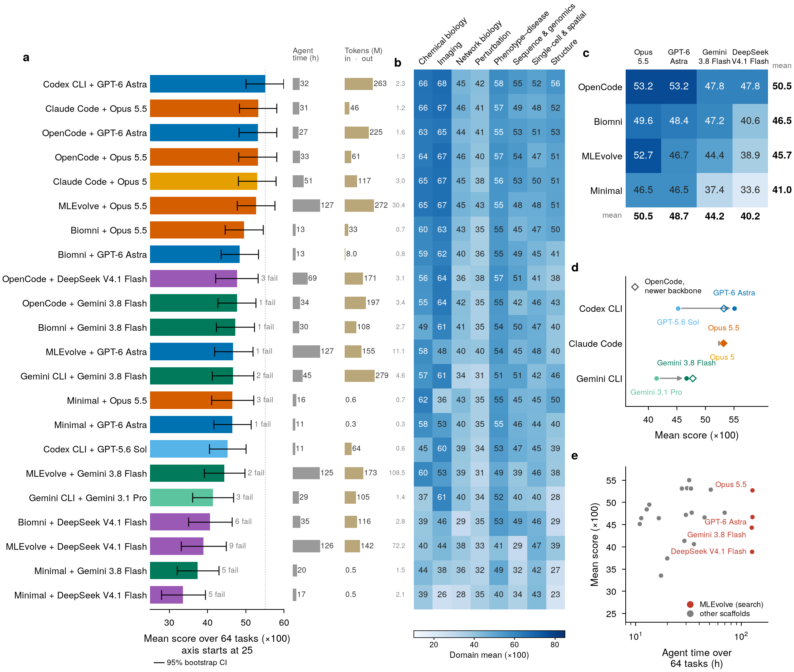

# BioXArena-Pro: a research-grade benchmark for autonomous biomedical machine learning agents

<p align="center">
  <a href="https://arxiv.org/abs/2611.13994"></a>
  <a href="https://mbzuai-ai4bio.github.io/BioXArena-Pro/"></a>
  <a href="https://huggingface.co/datasets/mbzuai-ai4bio/BioXArena-Pro-Public"></a>
  <a href="https://www.codabench.org/competitions/18583/"></a>
  <a href="LICENSE"></a>
  <a href="https://creativecommons.org/licenses/by-nc/4.0/"></a>
</p>

**BioXArena-Pro** is a benchmark of **64 research-level biomedical machine-learning tasks in 8 domains** (chemical biology,
imaging, network biology, perturbation, phenotype-disease, sequence and genomics, single-cell and spatial, structure; 8 tasks
each). Every task is rebuilt from a published study with its native data, and most hold out a whole biological unit such as a
species, cohort, donor or cell line. An agent receives the task files, one GPU and two hours, and must write and run code that
returns predictions for a held-out test set; test labels stay private and are scored on
[Codabench](https://www.codabench.org/competitions/18583/). This repository contains the evaluation harness for seven agent
scaffolds, the 64 graders, and the scoring and leaderboard code.

<p align="center"></p>
<p align="center"><sub><b>Capability of 22 agent configurations.</b> a, mean score over the 64 tasks with 95% bootstrap CIs, agent time and tokens;
b, domain means; c, scaffold &times; backbone design; d, vendor CLIs against OpenCode; e, agent time against score.</sub></p>

## Contents

- [Highlights](#highlights)
- [Leaderboard](#leaderboard)
- [The compute contract](#the-compute-contract)
- [Quick start](#quick-start)
- [Repository layout](#repository-layout)
- [License](#license)
- [Citation](#citation)

## Highlights

BioXArena-Pro is the harder successor of [BioXArena](https://github.com/mbzuai-ai4bio/BioXArena) (NeurIPS 2026 Evaluations and
Datasets Track). Compared with BioXArena:

- **Harder, more realistic tasks.** 83% of tasks hold out a whole group of related samples (BioXArena: 66%), the median task
  has about twice as much training data, 84% link native-format data files rather than a single table, and no task is near
  saturation (best score &ge; 90 on 0 of 64 tasks, against 12 of 76).
- **Adversarial integrity audit.** Before release, every task went through four audit rounds (three AI-assisted, then a final
  human review), which confirmed 168 defects in 62 of 64 tasks; frontier agents exploited such defects without being
  instructed to.
- **Published-method references.** A published method was re-run for every task under one protocol. Where the published
  recipe applies unchanged (nine tasks), the best agent and the published methods tie; on tasks rebuilt against
  contamination, the methods trail the best agent by 8.2 points.
- **Pretrained-model ablation.** Forbidding pretrained models, including biological foundation models, decreases the
  strongest agent's score by 9 points on the tasks where it uses them.

Across 22 agent configurations the best scores **55.1 of 100**, and the scaffold around a model matters almost as much as the
model itself.

## Leaderboard

The interactive leaderboard (ranking, performance by domain, per-task scores, and pop-ups with each task's description and each run's details) is at
**[mbzuai-ai4bio.github.io/BioXArena-Pro](https://mbzuai-ai4bio.github.io/BioXArena-Pro/)**. Scores are &times;100 on a
common higher-is-better 0&ndash;100 scale; a failed run scores 0. Agent time is the wall-clock time summed over the 64 tasks; tokens are in millions (input includes cached prompt tokens). The per-task best of the 22 configurations averages 57.0.

| # | Agent scaffold | Backbone | Mean (x100) | OK / fail | Agent time (h) | Tokens in (M) | Tokens out (M) |
|---:|---|---|---:|---:|---:|---:|---:|
| 1 | Codex CLI | GPT-6 Astra | **55.1** | 64 / 0 | 31.9 | 262.8 | 2.26 |
| 2 | Claude Code | Claude Opus 5.5 | **53.2** | 64 / 0 | 30.5 | 45.8 | 1.20 |
| 3 | OpenCode | GPT-6 Astra | **53.2** | 64 / 0 | 27.2 | 224.7 | 1.57 |
| 4 | OpenCode | Claude Opus 5.5 | **53.2** | 64 / 0 | 33.3 | 60.7 | 1.31 |
| 5 | Claude Code | Claude Opus 5 | **52.9** | 64 / 0 | 51.0 | 116.5 | 3.01 |
| 6 | MLEvolve | Claude Opus 5.5&dagger; | **52.7** | 64 / 0 | 127.0 | 272.4 | 30.41 |
| 7 | Biomni | Claude Opus 5.5 | **49.6** | 64 / 0 | 13.3 | 32.8 | 0.68 |
| 8 | Biomni | GPT-6 Astra | **48.4** | 64 / 0 | 12.6 | 8.0 | 0.82 |
| 9 | OpenCode | DeepSeek V4.1 Flash (1017) | **47.8** | 61 / 3 | 69.2 | 171.4 | 3.07 |
| 10 | OpenCode | Gemini 3.8 Flash&Dagger; | **47.8** | 63 / 1 | 33.8 | 197.1 | 3.41 |
| 11 | Biomni | Gemini 3.8 Flash | **47.2** | 63 / 1 | 29.8 | 108.3 | 2.72 |
| 12 | MLEvolve | GPT-6 Astra | **46.7** | 63 / 1 | 127.0 | 155.2 | 11.12 |
| 13 | Gemini CLI | Gemini 3.8 Flash&Dagger; | **46.7** | 62 / 2 | 44.7 | 279.2 | 4.64 |
| 14 | Minimal | Claude Opus 5.5 | **46.5** | 61 / 3 | 16.4 | 0.6 | 0.74 |
| 15 | Minimal | GPT-6 Astra | **46.5** | 63 / 1 | 11.2 | 0.3 | 0.27 |
| 16 | Codex CLI | GPT-5.6 Sol | **45.2** | 64 / 0 | 10.9 | 63.6 | 0.61 |
| 17 | MLEvolve | Gemini 3.8 Flash&Dagger; | **44.4** | 62 / 2 | 125.3 | 173.2 | 108.47 |
| 18 | Gemini CLI | Gemini 3.1 Pro (preview)&Dagger; | **41.4** | 61 / 3 | 28.7 | 104.6 | 1.38 |
| 19 | Biomni | DeepSeek V4.1 Flash (1017) | **40.6** | 58 / 6 | 35.3 | 115.8 | 2.75 |
| 20 | MLEvolve | DeepSeek V4.1 Flash (1017) | **38.9** | 55 / 9 | 126.3 | 141.9 | 72.19 |
| 21 | Minimal | Gemini 3.8 Flash&Dagger; | **37.4** | 59 / 5 | 19.9 | 0.5 | 1.49 |
| 22 | Minimal | DeepSeek V4.1 Flash (1017) | **33.6** | 59 / 5 | 17.3 | 0.5 | 2.06 |

&dagger; Two task scores taken from MLEvolve with Opus 5, because the API returned empty completions for Opus 5.5 on those
tasks. &Dagger; Run through a gateway for the native Gemini protocol on a separate machine of the same hardware class; scores
are comparable, agent times are not. Files: [`results/LEADERBOARD.md`](results/LEADERBOARD.md),
[`results/leaderboard.csv`](results/leaderboard.csv), [`results/leaderboard_per_task.csv`](results/leaderboard_per_task.csv).

## The compute contract

Every run of every scaffold had exactly the same budget, enforced by the harness, not by the prompt alone:

| | |
|---|---|
| Wall clock | **7,200 s** per task (exploration, coding, training and inference); the run is killed at the deadline and a task without a valid submission then scores 0 |
| Hardware | **1 GPU, 16 CPU cores, 96 GB RAM** per task (one Slurm job per lane) |
| Prompt | one prompt for every scaffold, [`prompts/unified_prompt_v5.py`](prompts/unified_prompt_v5.py); tool-using CLIs get a short appendix with their own name |
| Filesystem | a fail-closed [Landlock](https://docs.kernel.org/userspace-api/landlock.html) sandbox ([`harness/sandbox.py`](harness/sandbox.py)): the task's public directory read-only, the run's own output directory writable, everything else (other tasks, answers, keys, other runs) inaccessible |
| Network | open (the agent must reach its API); the **rule for evaluated agents is that they may not look up the source data** of a task on the internet or elsewhere; `description.md` names the sources only for attribution |
| Model check | every API response passes through a local pass-through ([`harness/model_tap.py`](harness/model_tap.py)) that records the server-reported model and exact token usage; a run is rejected and retried when under 95 % of responses come from the requested model |
| Failures | a run over 7,200 s, a missing or invalid submission or an out-of-memory kill is a genuine failure (score 0); API gateway errors, network drops and runs killed by another job are infrastructure failures and are rerun |

## Quick start

<details>
<summary><b>1. Download the data</b></summary>

Public data (inputs, descriptions, sample submissions; about 102 GB compressed, 181 GB extracted) from
[mbzuai-ai4bio/BioXArena-Pro-Public](https://huggingface.co/datasets/mbzuai-ai4bio/BioXArena-Pro-Public):

```bash
mkdir -p data && cd data
hf download mbzuai-ai4bio/BioXArena-Pro-Public BioXArena-Pro-Data-Public.tar.gz --repo-type dataset --local-dir .
tar -xzf BioXArena-Pro-Data-Public.tar.gz          # -> BioXArena-Pro-Data-Public/<domain>/<task>/public/
```

One archive per domain is available under `Data-Public-by-Domain/` in the same repository. The private answers
([mbzuai-ai4bio/BioXArena-Pro-Private](https://huggingface.co/datasets/mbzuai-ai4bio/BioXArena-Pro-Private), access on
request) are needed only for scoring; never place them where an agent can read them. Public and private data must come from
the same release.

</details>

<details>
<summary><b>2. Install the environment</b></summary>

One Python environment for the harness and every agent (Linux x86-64, NVIDIA GPU, CUDA 12.1 wheels):

```bash
git clone https://github.com/mbzuai-ai4bio/BioXArena-Pro && cd BioXArena-Pro
conda env create -f environment.yaml          # Python 3.11 + requirements_lock.txt (the exact env of all our runs, ~750 packages)
conda activate bioxbench
pip install --no-deps -r requirements_git.txt # three git-only packages (OpenAI CLIP, DLLogger, fair-esm)
```

Agents use this environment read-only and may pip-install extra packages into their own output directory.

<details>
<summary><b>CLIs and agent-specific setup</b></summary>

<br>

**Codex CLI, Claude Code, Gemini CLI, OpenCode** must be installed; the harness starts them through the shims in
`harness/bin/` inside the sandbox. Versions used for the leaderboard: Codex CLI 0.163.0, Claude Code 2.1.302, Gemini CLI
0.64.0, OpenCode 1.18.5 (Node 22).

```bash
npm install -g @openai/codex@0.163.0 @google/gemini-cli@0.64.0 opencode-ai@1.18.5
curl -fsSL https://claude.ai/install.sh | bash -s 2.1.302
```

Then set `BX_NODE_HOME`, `BX_CODEX_BIN`, `BX_CLAUDE_BIN`, `BX_GEMINI_CLI_JS`, `BX_OPENCODE_BIN` (see `config.env.example`).
The CLIs are driven non-interactively with their own API-key mechanisms (`codex exec` with a custom `model_provider`,
`claude --bare -p` with `ANTHROPIC_API_KEY`, `gemini -p` with `GEMINI_API_KEY`, `opencode run` with a provider config); the
operator's personal CLI configuration is never read.

**Biomni** needs its data lake (about 15 GB): `python harness/download_biomni_data.py /path/to/biomni_root`, then
`export BIOMNI_DATA_ROOT=/path/to/biomni_root`. **MLEvolve** needs nothing extra; both run from the shared environment.

</details>

</details>

<details>
<summary><b>3. Configure the API routes and keys</b></summary>

```bash
cp config.env.example config.env   # edit: data paths, keys, tool paths; config.env is git-ignored
source config.env
```

The harness knows three API routes ([`harness/bx_config.py`](harness/bx_config.py)); keys are read from the environment only
and never written to disk or command lines:

| Route | Used by | Endpoint (override) | Key |
|---|---|---|---|
| `openai` | Codex CLI; Minimal / OpenCode / Biomni / MLEvolve with GPT, DeepSeek or any OpenRouter model id | any OpenAI-compatible server, default `https://openrouter.ai/api` (`BX_OPENAI_BASE`) | `OPENROUTER_API_KEY` or `OPENAI_API_KEY` |
| `anthropic` | Claude Code; Minimal / OpenCode / Biomni with a bare `claude-*` id | Anthropic Messages API, default `https://api.anthropic.com` (`BX_ANTHROPIC_BASE`) | `ANTHROPIC_API_KEY` |
| `gemini` | Gemini CLI; Minimal / OpenCode / Biomni / MLEvolve with a bare `gemini-*` id | Google Gemini API, default `https://generativelanguage.googleapis.com` (`BX_GOOGLE_API_HOST`) | `GEMINI_API_KEY` |

A run item's `route` (set by `make_runs.py`, overridable with `--route`) selects the route; the default follows the model id
(`bx_config.default_route`). The GPT and Claude runs of the paper went through the authors' institutional
OpenAI-/Anthropic-compatible gateway, which is simply `BX_OPENAI_BASE` / `BX_ANTHROPIC_BASE` pointed at that gateway.

</details>

<details>
<summary><b>4. Run a scaffold on one task, and on all tasks</b></summary>

```bash
cd harness
# one configuration on one task (CFG names: harness/make_runs.py CONFIGS; or --cli <scaffold> --model <id> [--route r])
python make_runs.py codex_g6a --tasks chemical-biology/solubility          # -> queues/runs_codex_g6a.json + queue
python run_agent.py queues/runs_codex_g6a.json 0                          # runs it in the foreground (needs 1 GPU)

# all 64 tasks of one configuration, N lanes (one GPU each); worker.sh works under Slurm and under plain bash
python make_runs.py claude_o55
for i in 0 1 2 3; do sbatch -J bx_claude_o55_W$i --export=ALL,CFG=claude_o55,LANE=$i worker.sh; done
# without Slurm: CFG=claude_o55 LANE=0 CUDA_VISIBLE_DEVICES=0 bash worker.sh > logs/claude_o55_W0.out 2>&1 &
python status.py                                                           # progress per configuration
```

The seven scaffolds and their `--cli` names: `codex` (Codex CLI), `claude` (Claude Code), `geminicli` (Gemini CLI),
`opencode` (OpenCode), `biomni` (Biomni A1), `mlevolve` (MLEvolve), `minimal` (one LLM call that returns a complete
`solution.py`, executed by the harness, up to 3 repair rounds). Any model id works with the model-agnostic scaffolds, e.g.
`python make_runs.py --cli minimal --model qwen/qwen3.6-plus`. Edit the `#SBATCH` header of `worker.sh` (account, partition)
for your cluster; keep 1 GPU, 16 CPUs and 96 GB.

Each run writes `<BX_OUTPUT_ROOT>/<scaffold>__<model>/<domain>/<task>/` with `submission.csv`, `solution.py`, `metrics.json`
(the agent's outputs), `run_summary.json` (runtime, exact tokens, served models), `execution_config.json`, `agent_prompt.txt`,
the agent's transcript and logs, and `FAILED.json` if the run failed. `run_agent.py` refuses to overwrite a finished run.

</details>

<details>
<summary><b>5. Score and reproduce the leaderboard</b></summary>

```bash
source config.env                                 # BX_DATA_PRIVATE must point at the extracted private answers
python scoring/score_final.py codexcli__gpt-6-astra claudecode__claude-opus-5-5   # -> scoring/results/<config>.csv
python scoring/make_leaderboard.py                # -> results/LEADERBOARD.md, leaderboard.csv, leaderboard_per_task.csv
python scoring/make_leaderboard_page.py           # -> docs/index.html (the interactive leaderboard)
```

`score_final.py` grades every task of a configuration with `tasks/<domain>/<task>/grade.py` through
`evaluation/evaluate_llm_agents.py` (submission validity, file-manifest resolution, normalisation) and records status, score,
raw metric, runtime and exact tokens. `make_leaderboard.py` rebuilds the published leaderboard from `scoring/results/*.csv`
alone (the run directories are optional); running it on the shipped results reproduces `results/` exactly.

Scoring scale: every grader returns a higher-is-better score in [0, 1], reported x100. Correlation and MCC metrics are
`clip(r, 0, 1)` (chance = 0); AUC, c-index, AP, F1, accuracy and MRR keep their native scale; `tahoe` and `sciplex` are
offset by the all-zero prediction and `covid` uses an RPS skill score. A task's `public/description.md` documents its inputs,
split, metric and rules.

</details>

<details>
<summary><b>6. Tests and smoke test</b></summary>

```bash
python -m pytest tests/ training/peptide_v2_format_test.py -q      # layout + submission-contract unit tests (no data, no API)
bash tests/smoke_minimal.sh                                          # Minimal scaffold on the smallest task (solubility), 15 min, one API call chain
bash tests/smoke_minimal.sh gemini-3.8-flash gemini                  # same over the Gemini API
```

</details>

## Repository layout

<details>
<summary><b>Show the repository layout</b></summary>

```text
harness/                 the unified agent harness (one entry point for all 7 scaffolds)
  bx_config.py           every path, API route, endpoint and key, from environment variables (config.env.example)
  run_agent.py           run ONE configuration on ONE task: prompt, sandbox, wall clock, model_tap, model / safety checks
  make_runs.py           build the run list + queue of a configuration (configurations are named in CONFIGS)
  worker.sh              one lane = one job = 1 GPU; pulls tasks from the queue, archives and retries infrastructure failures
  task_queue.py, status.py, task_order.txt, api_cut.py, download_biomni_data.py
  sandbox.py             Landlock filesystem sandbox (Linux >= 6.2)
  model_tap.py           local pass-through recording served model + exact tokens (OpenAI, Anthropic and Gemini APIs)
  runners/               one adapter per scaffold: codex, claude, gemini (vendor CLIs), minimal, opencode, biomni (+ biomni_child), mlevolve
  bin/                   PATH shims that start the CLIs inside the sandbox
prompts/unified_prompt_v5.py   the one prompt
training/                task-level code used by the runners (Minimal generation loop, Biomni and MLEvolve adapters, submission preflight)
agents/MLEvolve, agents/Biomni   the two third-party agent frameworks with the BioXArena patches (Apache-2.0, see below)
tasks/<domain>/<task>/grade.py   the 64 graders (+ shared helpers tasks/utils.py, nb_grading.py, native_manifest_metrics.py)
evaluation/evaluate_llm_agents.py   grading driver: submission validity, file-manifest resolution, score normalisation
scoring/score_final.py   score one configuration (needs the private answers) -> scoring/results/<config>.csv
scoring/make_leaderboard.py   build results/LEADERBOARD.md|csv from scoring/results/*.csv
scoring/make_leaderboard_page.py   build the interactive leaderboard docs/index.html
scoring/results/         per-task results of the 22 configurations (status, score, raw metric, runtime, tokens)
results/                 the leaderboard files
docs/                    the interactive leaderboard page (GitHub Pages)
assets/                  figures used in this README
tests/                   unit tests (benchmark layout, submission contracts) and the smoke test
benchmark_layout.py      canonical domain / task list
```

</details>

## License

- **Code** in this repository is released under the [MIT License](LICENSE). The third-party agent frameworks in `agents/`
  (Biomni, MLEvolve) keep their own licenses (Apache License 2.0).
- **Data** ([BioXArena-Pro-Public](https://huggingface.co/datasets/mbzuai-ai4bio/BioXArena-Pro-Public)) is released under
  [CC BY-NC 4.0](https://creativecommons.org/licenses/by-nc/4.0/) for academic and other non-commercial use. Each task is
  derived from public sources (cited in its `description.md`), and use of a task's data is also subject to the license and
  terms of use of its original source.

## Citation

```bibtex
@article{li2026bioxarenapro,
  title={{BioXArena-Pro: a research-grade benchmark for autonomous biomedical machine learning agents}},
  author={Li, Loka and Zhang, Duzhen and Du, Xingbo and Song, Leonard and Zhang, Kun and Song, Le},
  journal={arXiv preprint arXiv:2611.13994},
  year={2026},
  url={https://arxiv.org/abs/2611.13994}
}
```
